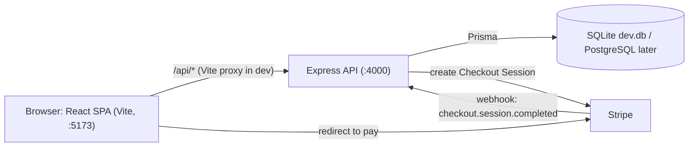
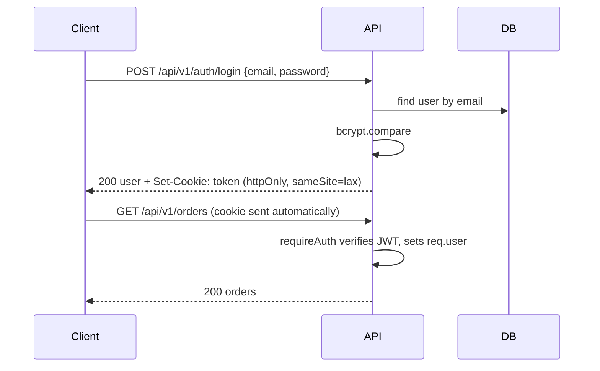
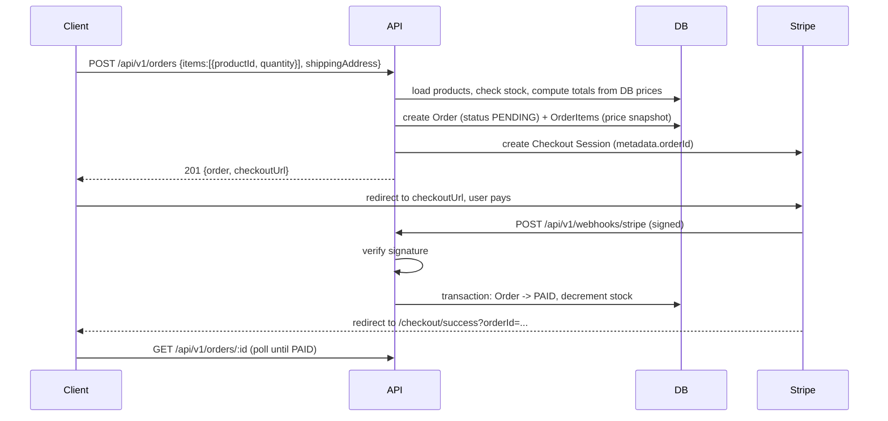

# 02. Architecture

## System overview


## Repository layout (monorepo, npm workspaces)
```
/
├── AGENTS.md                 # project rules, auto-loaded for every agent
├── package.json              # workspaces: ["client", "server"], root scripts
├── docs/                     # shared project context (source of truth)
├── .agents/skills/           # workflow procedures (work-on-task, review-phase)
├── client/
│   ├── index.html
│   ├── vite.config.ts        # proxy /api -> http://localhost:4000
│   └── src/
│       ├── main.tsx
│       ├── app/              # App.tsx, router.tsx, providers.tsx
│       ├── pages/            # one file per route (HomePage, ProductListPage, ...)
│       ├── components/
│       │   ├── ui/           # design-system primitives (Button, Input, Card, Badge, ...)
│       │   └── layout/       # Header, Footer, PageShell
│       ├── features/         # feature modules: products/, cart/, auth/, orders/, checkout/
│       │   └── <feature>/    # api.ts (queries), components/, hooks.ts, types.ts, store.ts
│       ├── lib/              # apiClient.ts, formatMoney.ts, queryClient.ts
│       └── styles/           # index.css (Tailwind + design tokens)
└── server/
    ├── .env.example
    ├── prisma/
    │   ├── schema.prisma
    │   ├── migrations/
    │   └── seed.ts
    └── src/
        ├── server.ts         # starts HTTP listener
        ├── app.ts            # builds the Express app (exported for tests)
        ├── config/env.ts     # loads and validates env with zod
        ├── lib/              # prisma.ts, stripe.ts, jwt.ts, password.ts, errors.ts
        ├── middleware/       # requireAuth, validate, errorHandler, notFound
        └── modules/          # one folder per domain
            └── <module>/     # <module>.routes.ts, .controller.ts, .service.ts, .schema.ts, .test.ts
                              # modules: auth, products, categories, cart, orders, payments
```

## Backend layering (per module)
`routes` (URL + middleware) → `controller` (HTTP in/out) → `service` (business logic, Prisma calls).
Zod schemas in `*.schema.ts` validate input. Services never touch `req`/`res`. Controllers never touch Prisma.

## Key flows

### Authentication


### Checkout and payment


### Cart
The cart lives on the client (Zustand + localStorage) as `[{productId, quantity}]`. Before checkout,
the client calls `POST /api/v1/cart/validate` to get current prices and stock. The server is the only
authority on prices. See ADR-003.

## Environments and ports
| | Dev |
|---|---|
| Client | http://localhost:5173 |
| API | http://localhost:4000/api/v1 |
| DB | `server/prisma/dev.db` (SQLite) |
| Stripe webhooks | Stripe CLI: `stripe listen --forward-to localhost:4000/api/v1/webhooks/stripe` |

## Environment variables (`server/.env`)
| Var | Example | Purpose |
|---|---|---|
| `PORT` | `4000` | API port |
| `DATABASE_URL` | `file:./dev.db` | Prisma connection |
| `JWT_SECRET` | random 32+ chars | Signs auth tokens |
| `JWT_EXPIRES_IN` | `7d` | Token lifetime |
| `CLIENT_URL` | `http://localhost:5173` | CORS origin and Stripe redirect base |
| `STRIPE_SECRET_KEY` | `sk_test_...` | Stripe API |
| `STRIPE_WEBHOOK_SECRET` | `whsec_...` | Verifies webhook signatures |
| `CURRENCY` | `inr` | Stripe currency |
