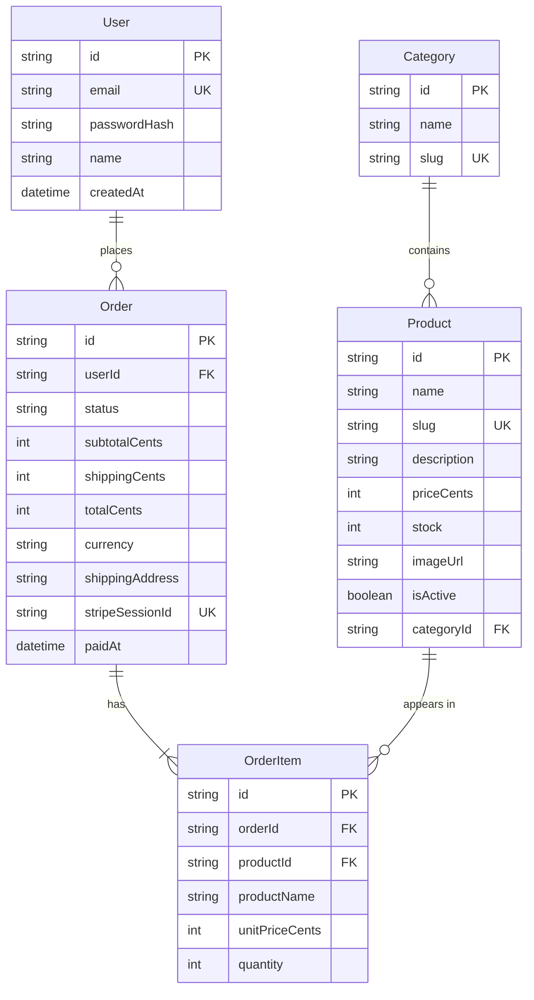

# 03. Data Model (CONTRACT)

> This is a contract. Change it only with an ADR in `DECISIONS.md`, and list the affected tasks.
> Phase 2 turns this into `server/prisma/schema.prisma`. Keep both in sync.

## Entity relationships


## Rules and reasons
| Rule | Why |
|---|---|
| IDs are `cuid()` strings | They are not guessable, and they are the same on SQLite and Postgres |
| Money is an `Int` in minor units (`*Cents`, which also holds paise) | Floats cause rounding errors, for example 0.1 + 0.2 ≠ 0.3 |
| `OrderItem` copies `productName` and `unitPriceCents` | Order history must not change when a product's price changes later |
| `Order.status` is a `String`: `PENDING`, `PAID`, `CANCELLED`, `FAILED` | Not every SQLite setup supports Prisma enums. Allowed values are checked with zod and a TS union type |
| `shippingAddress` is a JSON string in v1 | Keeps v1 simple. A separate `Address` table can come later |
| `Product.isActive` | Hide a product without deleting it. Old orders still reference it |
| Shipping is a flat rate: free above ₹999, else ₹49 | A simple business rule that lives in `orders.service.ts` |
| Stock goes down **only when the payment is confirmed** (webhook) | v1 does not reserve stock. Overselling is a known limit (see ADR-005) |

## Draft Prisma schema
```prisma
generator client {
  provider = "prisma-client-js"
}

datasource db {
  provider = "sqlite"            // becomes "postgresql" in Phase 10
  url      = env("DATABASE_URL")
}

model User {
  id           String   @id @default(cuid())
  email        String   @unique
  passwordHash String
  name         String
  createdAt    DateTime @default(now())
  updatedAt    DateTime @updatedAt
  orders       Order[]
}

model Category {
  id       String    @id @default(cuid())
  name     String
  slug     String    @unique
  products Product[]
}

model Product {
  id          String      @id @default(cuid())
  name        String
  slug        String      @unique
  description String
  priceCents  Int
  stock       Int         @default(0)
  imageUrl    String
  isActive    Boolean     @default(true)
  categoryId  String
  category    Category    @relation(fields: [categoryId], references: [id])
  orderItems  OrderItem[]
  createdAt   DateTime    @default(now())
  updatedAt   DateTime    @updatedAt

  @@index([categoryId])
  @@index([priceCents])
}

model Order {
  id              String      @id @default(cuid())
  userId          String
  user            User        @relation(fields: [userId], references: [id])
  status          String      @default("PENDING") // PENDING | PAID | CANCELLED | FAILED
  subtotalCents   Int
  shippingCents   Int
  totalCents      Int
  currency        String
  shippingAddress String      // JSON: {fullName, line1, line2?, city, state, postalCode, country, phone}
  stripeSessionId String?     @unique
  paidAt          DateTime?
  items           OrderItem[]
  createdAt       DateTime    @default(now())
  updatedAt       DateTime    @updatedAt

  @@index([userId, createdAt])
}

model OrderItem {
  id             String  @id @default(cuid())
  orderId        String
  order          Order   @relation(fields: [orderId], references: [id], onDelete: Cascade)
  productId      String
  product        Product @relation(fields: [productId], references: [id])
  productName    String
  unitPriceCents Int
  quantity       Int
}
```

## Seed data (Phase 2)
- 4 categories: Electronics, Clothing, Home & Kitchen, Books
- About 24 products, 6 per category, with image URLs from https://picsum.photos/seed/<slug>/600/600
- 1 demo user: `demo@shoplearn.dev` / `Password123!`

## SQLite → PostgreSQL notes (Phase 10)
- SQLite has no case-insensitive `mode: 'insensitive'` filter. In v1, search uses `contains` on the
  name and description, which is case-insensitive for ASCII in SQLite. On Postgres, add `mode: 'insensitive'`.
- Switch `provider`, start fresh migrations, then re-seed.
