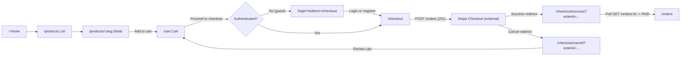

# 05. UI Design (CONTRACT)

> Finalized in Phase 1 (T1.1–T1.4). The **design tokens**, **route table**, and **UI primitive APIs**
> below are a contract for Phase 5+ frontend implementation.

## Design principles
1. **Clean and product-first.** Generous white space so product photography and pricing stand out.
2. **Mobile-first.** Designed at `375px` width first, scaling up at `md` (`768px`) and `lg` (`1024px+`).
3. **Accessible (WCAG 2.1 AA).** Normal text contrast >= `4.5:1`, visible `2px` focus ring on all interactive controls, `<label>` on every input, semantic landmarks and ARIA attributes, full keyboard navigation.
4. **Consistent.** Every page builds from `client/src/components/ui/*` primitives. No one-off styled buttons or raw hex colors in components.
5. **Four states for every async view:** `loading` (Skeleton / Spinner), `empty` (EmptyState), `error` (Alert with retry), and `success`.

---

## Sitemap and routes (CONTRACT)
| Route | Page | Auth | Main data / API | Notes |
|---|---|---|---|---|
| `/` | `HomePage` | Public | `GET /categories`, `GET /products?limit=8` | Hero, category strip, featured products |
| `/products` | `ProductListPage` | Public | `GET /products?...`, `GET /categories` | Filters (`search`, `category`, `minPrice`, `maxPrice`, `sort`, `page`, `limit`) live in URL query params |
| `/products/:slug` | `ProductDetailPage` | Public | `GET /products/:slug` | Gallery, price, stock badge, quantity stepper, add-to-cart |
| `/cart` | `CartPage` | Public | `POST /cart/validate` | Zustand persisted cart validated against server prices/stock |
| `/login` | `LoginPage` | Guest only | `POST /auth/login` | Honors `?redirect=...` (defaults to `/`); redirects away if already logged in |
| `/register` | `RegisterPage` | Guest only | `POST /auth/register` | Honors `?redirect=...` (defaults to `/`); redirects away if already logged in |
| `/checkout` | `CheckoutPage` | Protected | `POST /cart/validate`, `POST /orders` | Unauthenticated users redirect to `/login?redirect=/checkout` |
| `/checkout/success` | `CheckoutSuccessPage` | Protected | `GET /orders/:id` (`?orderId=...`) | Polls order until `PAID` (with timeout fallback) |
| `/checkout/cancel` | `CheckoutCancelPage` | Protected | `GET /orders/:id` (optional `?orderId=...`) | Explains payment was cancelled; links back to `/cart` |
| `/orders` | `OrderHistoryPage` | Protected | `GET /orders` | User's past orders, newest first |
| `/orders/:id` | `OrderDetailPage` | Protected | `GET /orders/:id` | Line items, shipping address, totals, status (`403`/`404` handled) |
| `/styleguide` | `StyleguidePage` | Dev only | – | Design tokens and UI primitives showcase |
| `*` | `NotFoundPage` | Public | – | Friendly 404 with link back to `/` and `/products` |

---

## Key user flows

### 1. Browse, cart, guest checkout redirect, and payment

### 2. Error & empty state handling across flows
- **Unauthenticated (`401 UNAUTHENTICATED`):** Protected routes (`/checkout`, `/checkout/*`, `/orders`, `/orders/:id`) redirect to `/login?redirect=<currentPath>`. On `/login`, invalid credentials show a single generic `Alert` (`"Invalid email or password"`).
- **Validation (`400 VALIDATION_ERROR`):** Forms (`Login`, `Register`, `Checkout`) validate client-side with `zod` and map server `details` field errors under each `FormField`.
- **Cart & stock conflicts (`POST /cart/validate` issues or `409 CONFLICT` on `POST /orders`):**
  - `NOT_FOUND` / `INACTIVE`: show a `danger` `Alert` on the cart line and prompt removal.
  - `INSUFFICIENT_STOCK`: show a `warning` `Alert` with the available count and clamp or adjust quantity.
  - Checkout is blocked until all cart issues are resolved.
- **Forbidden / missing resource (`403 FORBIDDEN`, `404 NOT_FOUND`):** Show an `Alert` or `EmptyState` explaining the resource is unavailable, with navigation back to `/orders` or `/products`.
- **Network / `500 INTERNAL_ERROR`:** Show a `danger` `Alert` with a **Retry** button that refetches the query.
- **Empty states:**
  - `/products` with no matches: `EmptyState` ("No products match your filters") with a "Clear filters" action.
  - `/cart` with 0 items: `EmptyState` ("Your cart is empty") with a "Browse products" CTA.
  - `/orders` with 0 orders: `EmptyState` ("No orders yet") with a "Start shopping" CTA.

---

## Design tokens (CONTRACT)
Defined as CSS variables inside `@theme` in `client/src/styles/index.css` so Tailwind v4 generates matching utilities (`bg-primary`, `text-muted`, `rounded-md`, `shadow-card`, etc.). **Never hard-code hex colors in components.**

### Color palette & WCAG AA contrast audit
| Token | Hex | Contrast check | Intended use |
|---|---|---|---|
| `--color-bg` | `#ffffff` | Base canvas | Page background |
| `--color-surface` | `#f8fafc` | `0.95` luminance | Cards, filter sidebar, subtle panels |
| `--color-surface-hover` | `#f1f5f9` | Hover state on surface | Secondary button hover, table rows |
| `--color-text` | `#0f172a` | `17.8:1` on `bg`, `17.0:1` on `surface` (AAA) | Primary body text, headings |
| `--color-muted` | `#64748b` | `4.76:1` on `bg`, `4.55:1` on `surface` (AA) | Captions, hints, secondary labels |
| `--color-border` | `#e2e8f0` | UI border | Card borders, dividers, inputs |
| `--color-primary` | `#4f46e5` | `6.29:1` with `#ffffff` text (AA+) | Primary buttons, links, active states |
| `--color-primary-hover` | `#4338ca` | `7.90:1` with `#ffffff` text (AAA) | Primary button hover |
| `--color-accent` | `#f59e0b` | `9.0:1` with `--color-text` (`#0f172a`) (AAA) | Sale/highlight badges (**always pair with dark text, never white**) |
| `--color-success` | `#15803d` | `5.01:1` on `bg` (AA) | Success text, paid status |
| `--color-success-bg` | `#f0fdf4` | `4.75:1` with `--color-success` (AA) | Success alert/badge background |
| `--color-warning` | `#b45309` | `5.02:1` on `bg` (AA) | Warning text, pending/low-stock status |
| `--color-warning-bg` | `#fffbeb` | `4.82:1` with `--color-warning` (AA) | Warning alert/badge background |
| `--color-danger` | `#dc2626` | `4.83:1` on `bg` (AA) | Error text, destructive actions |
| `--color-danger-bg` | `#fef2f2` | `4.56:1` with `--color-danger` (AA) | Error alert/badge background |
| `--color-info` | `#1d4ed8` | `6.70:1` on `bg` (AA+) | Info text |
| `--color-info-bg` | `#eff6ff` | `6.22:1` with `--color-info` (AA+) | Info alert/badge background |

### Typography, spacing, radii & elevation
- **Font family:** `--font-sans: 'Inter', ui-sans-serif, system-ui, sans-serif`
- **Type scale:** `12px` (`text-xs`), `14px` (`text-sm`), `16px` (`text-base`), `20px` (`text-xl`), `24px` (`text-2xl`), `32px` (`text-3xl`), `40px` (`text-4xl`)
- **Spacing:** `4px` base grid (Tailwind default spacing scale)
- **Radii:** `--radius-sm: 6px`, `--radius-md: 10px`, `--radius-lg: 16px`
- **Shadows:** `--shadow-card: 0 1px 3px rgb(0 0 0 / 0.08)`
- **Focus ring:** `focus-visible:outline-2 focus-visible:outline-offset-2 focus-visible:outline-primary`

---

## Wireframes
Full low-fidelity mobile (`375px`) and desktop (`1024px+`) wireframes for every route—including **loading**, **empty**, and **error** states—live in [docs/design/wireframes.md](design/wireframes.md).

---

## Component inventory (CONTRACT)

### UI primitives (`client/src/components/ui/`)
| Component | Key props / variants | Purpose |
|---|---|---|
| `Button` | `variant`: `primary \| secondary \| ghost \| danger`; `size`: `sm \| md \| lg`; `loading?: boolean` | Accessible action button with loading spinner |
| `Input` | `error?: boolean`, forwards `ref` | Text/number/email/password input compatible with `react-hook-form` |
| `Select` | `error?: boolean`, forwards `ref` | Styled native `<select>` compatible with `react-hook-form` |
| `Label` | `required?: boolean` | Form field label |
| `FormField` | `label`, `htmlFor`, `error?`, `hint?`, `required?` | Wraps `Label` + control + hint + accessible error message |
| `Card` | `Card`, `CardHeader`, `CardContent`, `CardFooter` | Surface container with border, radius, and `shadow-card` |
| `Badge` | `variant`: `neutral \| primary \| accent \| success \| warning \| danger`; `size`: `sm \| md` | Compact status/category pill |
| `Skeleton` | `className` | Animated loading placeholder (`aria-hidden="true"`) |
| `Spinner` | `size`: `sm \| md \| lg`; `label?` | Accessible loading indicator (`role="status"`) |
| `Alert` | `variant`: `info \| success \| warning \| danger`; `title?`; `onRetry?` | Inline feedback banner with optional retry action |
| `Price` | `cents: number`; `currency?: string` | Formats integer minor units via `Intl.NumberFormat` |
| `QuantityStepper` | `value`, `onChange`, `min?`, `max?`, `disabled?` | Accessible `-` / `+` quantity control |
| `Pagination` | `page`, `totalPages`, `onPageChange` | Page navigation with prev/next and ellipsis |
| `EmptyState` | `title`, `description?`, `icon?`, `action?` | Consistent zero-results / empty-list view |

### Layout components (`client/src/components/layout/`, built in Phase 5)
- `Header` (logo, search bar, cart link with item count badge, user/auth menu)
- `Footer`
- `PageShell` (header + main + footer)
- `Container` (`max-w-7xl mx-auto px-4 sm:px-6 lg:px-8`)

### Feature components (built in Phases 5–8)
- **Catalog:** `ProductCard`, `ProductGrid`, `ProductFilters`, `SortSelect`
- **Cart:** `CartLineItem`, `CartSummary`
- **Checkout & Orders:** `AddressForm`, `OrderSummary`, `OrderStatusBadge`, `OrderCard`
