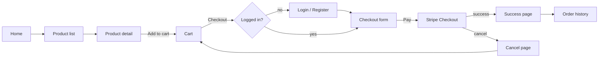

# 05. UI Design

> Phase 1 (Design) fills in and finalizes this doc. Sections marked **DRAFT** get replaced by the
> Phase 1 tasks. After Phase 1, the **design tokens** and **route table** are a contract.

## Design principles
1. **Clean and product-first.** Lots of white space, and the images do the talking.
2. **Mobile-first.** Design for 375px wide, then scale up to `md` (768px) and `lg` (1024px).
3. **Accessible.** Text contrast at least 4.5:1, a visible focus ring, labels on every input, works with the keyboard.
4. **Consistent.** Every page uses `components/ui/*` primitives. No one-off styled buttons.
5. **Every async view has 4 states:** loading (skeleton), empty, error (with retry), success.

## Sitemap and routes (contract after Phase 1)
| Route | Page | Auth | Main data |
|---|---|---|---|
| `/` | HomePage: hero, categories, featured products | – | `GET /categories`, `GET /products?limit=8` |
| `/products` | ProductListPage: filters sidebar, grid, pagination | – | `GET /products?...` (filters live in the URL query string) |
| `/products/:slug` | ProductDetailPage | – | `GET /products/:slug` |
| `/cart` | CartPage | – | `POST /cart/validate` |
| `/login`, `/register` | Auth pages | guest only | `POST /auth/*` |
| `/checkout` | CheckoutPage: address form and order summary | ✅ | `POST /cart/validate`, `POST /orders` |
| `/checkout/success` | Payment success: polls the order | ✅ | `GET /orders/:id` |
| `/checkout/cancel` | Payment cancelled | ✅ | – |
| `/orders` | OrderHistoryPage | ✅ | `GET /orders` |
| `/orders/:id` | OrderDetailPage | ✅ | `GET /orders/:id` |
| `*` | NotFoundPage | – | – |

## Key user flow


## Design tokens (DRAFT, finalized in T1.2)
Defined as CSS variables in `client/src/styles/index.css` and mapped to Tailwind theme values.
| Token | Value | Use |
|---|---|---|
| `--color-primary` | `#4F46E5` (indigo-600) | Main buttons, links |
| `--color-primary-hover` | `#4338CA` | |
| `--color-accent` | `#F59E0B` (amber-500) | Sale badges, highlights |
| `--color-bg` | `#FFFFFF` | Page background |
| `--color-surface` | `#F8FAFC` (slate-50) | Cards, sidebar |
| `--color-text` | `#0F172A` (slate-900) | Body text |
| `--color-muted` | `#64748B` (slate-500) | Secondary text |
| `--color-border` | `#E2E8F0` (slate-200) | |
| `--color-success` / `--color-danger` | `#16A34A` / `#DC2626` | Status messages |
| Font | `Inter`, system-ui fallback | |
| Type scale | 12 / 14 / 16 / 20 / 24 / 32 / 40 px | |
| Spacing | 4px base (Tailwind default) | |
| Radius | `--radius-sm: 6px`, `--radius-md: 10px`, `--radius-lg: 16px` | |
| Shadow | `--shadow-card: 0 1px 3px rgb(0 0 0 / .08)` | |

## Component inventory (DRAFT, finalized in T1.4)
**UI primitives (`components/ui`):** Button (primary, secondary, ghost, danger; sm, md, lg; loading),
Input, Select, Label, FormField (label + input + error), Card, Badge, Skeleton, Spinner, Alert,
QuantityStepper, Pagination, EmptyState, Price (formats minor units).

**Layout:** Header (logo, search box, cart icon with count, user menu), Footer, PageShell, Container.

**Feature components:** ProductCard, ProductGrid, ProductFilters, SortSelect, CartLineItem,
CartSummary, AddressForm, OrderSummary, OrderStatusBadge, OrderCard.

## Wireframes (DRAFT, T1.3 replaces these with real low-fi wireframes)
```
Product list (desktop)
┌───────────────────────────────────────────────────────────┐
│ LOGO        [ search products...        ]     🛒 3   👤   │
├──────────────┬────────────────────────────────────────────┤
│ Category     │ 57 results            Sort: [Newest ▾]     │
│ ○ All        │ ┌──────┐ ┌──────┐ ┌──────┐ ┌──────┐        │
│ ○ Electronics│ │ img  │ │ img  │ │ img  │ │ img  │        │
│ Price        │ │ name │ │ name │ │ name │ │ name │        │
│ [min]-[max]  │ │ ₹999 │ │ ₹499 │ │ ₹1299│ │ ₹249 │        │
│ [Apply]      │ └──────┘ └──────┘ └──────┘ └──────┘        │
│              │            ‹ 1 2 3 4 5 ›                    │
└──────────────┴────────────────────────────────────────────┘
```
