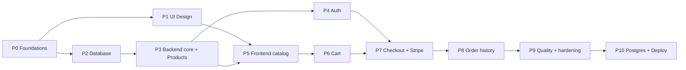

# Roadmap and Task Board

> **The single place for task status.** Every agent reads this before working and updates it after.
> Status values: `todo` · `in_progress` · `blocked` · `review` · `done`
> A task may start only when every task in its **Depends on** list is `done`.
> **Owns** = the only paths that task may edit. Tasks whose `Owns` paths do not overlap can run in parallel.
> Every task also reads `AGENTS.md` and `docs/06-CONVENTIONS.md`. The **Read** field lists the extra docs it needs.

## Phase overview and parallel lanes

**Design lane (P1)** and **data lane (P2 → P3)** run in parallel after P0. The frontend can also be
built against the API contract with mocked data before the backend is done.

| Phase | Goal | You will learn | Status |
|---|---|---|---|
| P0 | Monorepo, tooling, both apps start | npm workspaces, Vite, TS config, ESLint/Prettier | done |
| P1 | Finished UI design: flows, tokens, wireframes, components | UX basics, design systems, accessibility | done |
| P2 | Prisma schema, migration, seed | Relational modeling, migrations, ORMs | done |
| P3 | Express skeleton, error handling, products and categories API | REST, middleware, validation, pagination, filtering | done |
| P4 | Register, login, logout, me, protected routes (API + UI) | Hashing, JWT, cookies, CORS, auth context | done |
| P5 | Layout, routing, home, product list and detail pages | React Router, TanStack Query, URL state, component design | done |
| P6 | Cart store, cart page, cart validation API | Client state, persistence, server-side validation | done |
| P7 | Orders API, Stripe Checkout, webhook, checkout UI | Transactions, payment flows, webhooks, idempotency | done |
| P8 | Order history list and detail | Authorization (owning a resource), data display | done |
| P9 | Tests, security pass, accessibility, performance | Testing pyramid, OWASP basics, Lighthouse | done |
| P10 | Move to PostgreSQL, deploy | Production DB, env management, hosting | done |

---

## P0. Foundations
**T0.1 Monorepo root setup** · `done` · Depends on: – · Owns: `/package.json`, `/.gitignore`, `/.prettierrc`, `/.prettierignore`, `/.editorconfig`, `/tsconfig.base.json`, `/eslint.config.js`, `/README.md`
- Read: 02-ARCHITECTURE (repo layout)
- Done when: npm workspaces `client` + `server` are declared; root scripts `dev`, `build`, `test`, `typecheck` exist (they may be stubs); `.gitignore` covers `node_modules`, `.env`, `*.db`, `dist`.

**T0.2 Server scaffold** · `done` · Depends on: T0.1 · Owns: `/server/**` (except `prisma/`)
- Read: 02-ARCHITECTURE, 04-API_CONTRACT (health)
- Done when: Express + TS (tsx for dev), `src/app.ts` + `src/server.ts`, `config/env.ts` with zod, `.env.example`; `GET /api/v1/health` returns `{data:{status:"ok"}}`; `npm run dev -w server` works.

**T0.3 Client scaffold** · `done` · Depends on: T0.1 · Owns: `/client/**`
- Read: 02-ARCHITECTURE, 05-UI_DESIGN (tokens)
- Done when: Vite React TS app, Tailwind set up, proxy `/api` → `:4000`, folder skeleton created, placeholder home page renders.

**T0.4 Run everything together** · `done` · Depends on: T0.2, T0.3 · Owns: `/package.json` (scripts)
- Done when: `npm run dev` at the root starts both apps (using `concurrently`); the client shows the health status it fetched from the API.

> T0.2 and T0.3 can run **in parallel**.

## P1. UI Design (parallel with P2–P3)
**T1.1 User flows and sitemap** · `done` · Depends on: T0.1 · Owns: `docs/05-UI_DESIGN.md` (Sitemap, Flow sections)
- Done when: every route is confirmed, the flows cover guest checkout redirect, errors and empty states.

**T1.2 Design system tokens** · `done` · Depends on: T1.1 · Owns: `docs/05-UI_DESIGN.md` (Tokens), `client/src/styles/index.css`
- Done when: tokens are final, contrast is checked, the Tailwind theme is mapped, and a small `/styleguide` dev route shows them.

**T1.3 Wireframes for every page** · `done` · Depends on: T1.1 · Owns: `docs/05-UI_DESIGN.md` (Wireframes), `docs/design/**`
- Done when: low-fi wireframes exist for each route at mobile and desktop sizes, with loading, empty and error states noted.

**T1.4 Component inventory and UI primitives** · `done` · Depends on: T1.2, T0.3 · Owns: `client/src/components/ui/**`, `docs/05-UI_DESIGN.md` (Components)
- Done when: Button, Input, FormField, Card, Badge, Skeleton, Alert, Price, QuantityStepper, Pagination and EmptyState are built and shown on `/styleguide`.

> T1.2 and T1.3 can run **in parallel**.

## P2. Database
**T2.1 Prisma setup** · `done` · Depends on: T0.2 · Owns: `server/prisma/**`, `server/src/lib/prisma.ts`
- Read: 03-DATA_MODEL
- Done when: Prisma is installed, SQLite `DATABASE_URL` is set, the Prisma client singleton is in `lib/prisma.ts`.

**T2.2 Schema and first migration** · `done` · Depends on: T2.1 · Owns: `server/prisma/schema.prisma`, `server/prisma/migrations/**`
- Read: 03-DATA_MODEL
- Done when: the schema matches the data model doc, `prisma migrate dev --name init` succeeds, and the tables are visible in Prisma Studio.

**T2.3 Seed script** · `done` · Depends on: T2.2 · Owns: `server/prisma/seed.ts`
- Done when: `npm run db:seed` creates 4 categories, about 24 products and the demo user (bcrypt hash), and is safe to run again (re-runnable).

## P3. Backend core and catalog API
**T3.1 App plumbing** · `done` · Depends on: T0.2 · Owns: `server/src/middleware/**`, `server/src/lib/errors.ts`, `server/src/app.ts`
- Read: 04-API_CONTRACT (conventions)
- Done when: `AppError`, `errorHandler`, `notFound`, `validate(schema)`, CORS (with credentials), cookie-parser, helmet and request logging are in place; the error format matches the contract.

**T3.2 Categories API** · `done` · Depends on: T3.1, T2.3 · Owns: `server/src/modules/categories/**`
- Done when: `GET /categories` works and has a test.

**T3.3 Products API** · `done` · Depends on: T3.1, T2.3 · Owns: `server/src/modules/products/**`
- Read: 04-API_CONTRACT (products), 03-DATA_MODEL
- Done when: list (search, category, price range, sort, pagination, `meta`) and detail by slug work; invalid query returns 400; tests cover the filters.

> T3.2 and T3.3 can run **in parallel**.

## P4. Authentication
**T4.1 Auth API** · `done` · Depends on: T3.1, T2.2 · Owns: `server/src/modules/auth/**`, `server/src/lib/jwt.ts`, `server/src/lib/password.ts`, `server/src/middleware/requireAuth.ts`
- Read: 04-API_CONTRACT (auth), 02-ARCHITECTURE (auth flow)
- Done when: register, login, logout and me work with an httpOnly cookie; `requireAuth` sets `req.user`; tests cover duplicate email, wrong password and missing cookie.

**T4.2 Auth UI** · `done` · Depends on: T4.1 (or mocks), T1.4, T5.1 · Owns: `client/src/features/auth/**`, `client/src/pages/LoginPage.tsx`, `client/src/pages/RegisterPage.tsx`
- Done when: login and register forms validate, `useMe()` hook, header user menu, `<ProtectedRoute>` redirects to `/login?redirect=...`, logout works.

## P5. Frontend catalog
**T5.1 App shell and routing** · `done` · Depends on: T1.4 · Owns: `client/src/app/**`, `client/src/components/layout/**`, `client/src/lib/**`, `client/src/pages/NotFoundPage.tsx`
- Done when: router has every route (placeholders are fine), Header and Footer, `apiClient`, QueryClient provider, `formatMoney`.

**T5.2 Product list page** · `done` · Depends on: T5.1, T3.3 · Owns: `client/src/features/products/**`, `client/src/pages/ProductListPage.tsx`
- Done when: grid, filters, sort, search and pagination are all synced with the URL; skeleton, empty and error states work.

**T5.3 Product detail page** · `done` · Depends on: T5.2 · Owns: `client/src/pages/ProductDetailPage.tsx`
- Done when: image, info, stock status, quantity and an "Add to cart" button (wired up in P6); 404 state.

**T5.4 Home page** · `done` · Depends on: T5.2, T3.2 · Owns: `client/src/pages/HomePage.tsx`
- Done when: hero, category tiles linking to filtered lists, featured products.

## P6. Cart
**T6.1 Cart validate API** · `done` · Depends on: T3.3 · Owns: `server/src/modules/cart/**`, `server/src/lib/pricing.ts`
- Done when: `POST /cart/validate` returns lines, totals and issues; shipping rule lives in `pricing.ts`; tested.

**T6.2 Cart store and UI** · `done` · Depends on: T5.3 · Owns: `client/src/features/cart/**`, `client/src/pages/CartPage.tsx`
- Done when: Zustand persisted store (add, remove, setQty, clear), header count, cart page shows validated prices and issues, and the store has tests.

> T6.1 and T6.2 can run **in parallel** (both follow the contract).

## P7. Checkout and payments
**T7.1 Orders create API** · `done` · Depends on: T4.1, T6.1 · Owns: `server/src/modules/orders/**`
- Done when: `POST /orders` validates stock, snapshots prices, creates a PENDING order and returns `checkoutUrl` (Stripe is called through `lib/stripe.ts`).

**T7.2 Stripe integration and webhook** · `done` · Depends on: T7.1 · Owns: `server/src/lib/stripe.ts`, `server/src/modules/payments/**`
- Done when: Checkout Session is created; webhook verifies the signature, is idempotent, and marks the order PAID with stock decremented in a transaction; tested with the Stripe CLI.

**T7.3 Checkout UI** · `done` · Depends on: T6.2, T4.2 · Owns: `client/src/features/checkout/**`, `client/src/pages/Checkout*.tsx`
- Done when: address form, order summary, redirect to Stripe; success page polls until PAID and clears the cart; cancel page.

## P8. Order history
**T8.1 Orders read API** · `done` · Depends on: T7.1 · Owns: `server/src/modules/orders/**` (read routes)
- Done when: list and detail work; a non-owner gets 403; tested.

**T8.2 Order history UI** · `done` · Depends on: T8.1, T7.3 · Owns: `client/src/features/orders/**`, `client/src/pages/Order*.tsx`
- Done when: list with status badges and a detail page with items, address and totals.

## P9. Quality and hardening
**T9.1 Test coverage pass** · `done` · Depends on: P8 · Owns: `**/*.test.ts(x)`
**T9.2 Security review** (rate-limit auth, helmet, CORS, cookie flags, input limits) · `done` · Depends on: P8
**T9.3 Accessibility and performance** (keyboard, labels, Lighthouse ≥ 90, image lazy-load) · `done` · Depends on: P8

## P10. Production
**T10.1 Switch to PostgreSQL** (Neon or Supabase free tier) · `done` · Depends on: P9
**T10.2 Deploy** (client on Vercel or Netlify, API on Render or Railway, Stripe webhook in production) · `done` · Depends on: T10.1
